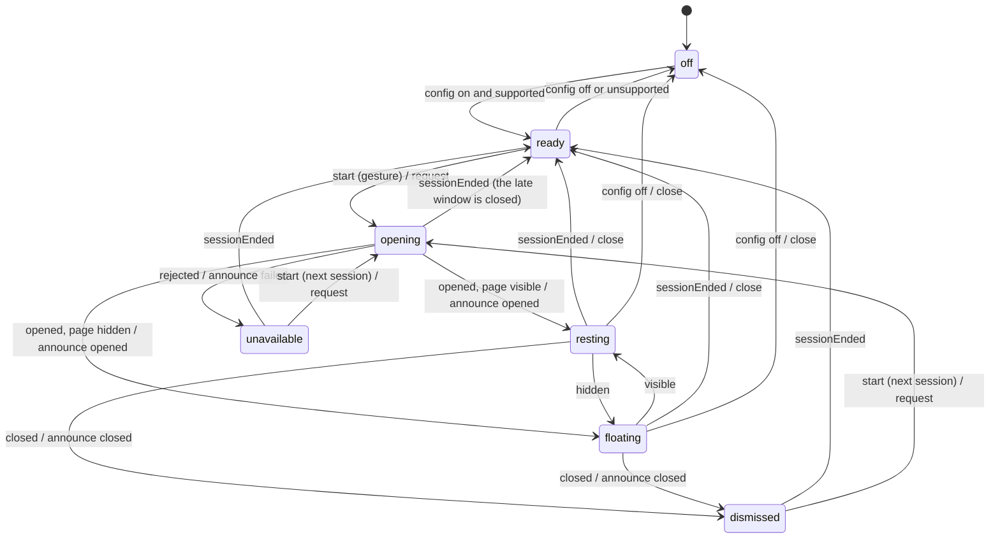

# Design: The ghost follows you

## Overview
When a focus candle is lit and the person switches away, the ghost goes with them in two layers.

1. **The fallback (every browser, no permission).** The tab's favicon is a candle drawn on a canvas that burns down in 24 steps as the session runs. While the page is hidden during a running focus session it becomes the ghost's face. The tab title keeps the time left. Back on the tab the icon returns to the candle.
2. **The follow window (opt-in, where the browser allows it).** With "Let her follow me" on, pressing "Light a candle" opens a small always-on-top Document Picture-in-Picture window with the ghost, the time left and one kind line. The ghost is at full strength while the person is away and fades to 25% when they return. Closing the window costs nothing.

The feature only reads the timer, the clock and the Page Visibility state. It owns no timer rule, and nothing it does can reach the reducer, so the never-punish rule holds by construction (Requirement 11). It is split the way the rest of the app is: pure helpers in `src/core` that take `now`, a port in `src/adapters/pip` with a browser adapter and a fake, and one small app-level object that wires them (`src/app/follow.ts`).

### Sources
Looked up with the Context7 MCP server in this session. Library `/wicg/document-picture-in-picture` (WICG, "Document Picture-in-Picture", source reputation High, 158 snippets), three queries.

Used from Context7:
- `requestWindow(options)` returns `Promise<Window>`; it resolves with the active window of a new top-level window whose document is `about:blank`, after the `enter` event is queued.
- Options: `width` and `height` (CSS pixels, hints the browser may clamp or ignore; a `width` without a `height` throws `RangeError`), `disallowReturnToOpener` (default false) and `preferInitialWindowPlacement` (default false).
- It rejects with `NotSupportedError` when the browser does not support the API, `NotAllowedError` when called without transient activation, from an iframe, or from inside a Picture-in-Picture window, and `RangeError` for half a size.
- The returned window fires `pagehide` when it closes for any reason, whether the site or the person closed it. The README's example listens with `{ once: true }` and compares `this` with the stored window.
- `documentPictureInPicture.window` is the open window or `null`. `documentPictureInPicture` also fires an `enter` event whose `window` is the new window.
- At most one window is open per top-level tab; calling `requestWindow` closes an existing one. The window never outlives its opener and closes when either document is destroyed or navigated. Whether one window exists across all tabs is up to the browser. The window always floats on top of other windows.
- Support is "implementation-defined and might vary according to user preferences", so the app must detect it, never assume it.

Not returned by Context7, so **unverified and from memory**: which browsers ship it (desktop Chromium browsers from version 116; not Firefox or Safari at the time of writing), that the new window starts without the opener's stylesheets, that the window's own timers are not throttled while the opener tab is hidden, how headless Chromium behaves, and how Page Visibility reports a tab that is only partly covered by another app. Each is repeated in "Open questions" with a way to check it. Section "Browser support" below is written so that a wrong guess here costs nothing: the app tests `'documentPictureInPicture' in window` at run time.

## The files to add or change

| File | Change | Purpose |
|---|---|---|
| `src/core/favicon.ts` | add | `WAX_STEPS`, `FaviconFrame`, `waxStep`, `faviconFrame`, `frameKey`. Pure. |
| `src/core/tab-title.ts` | add | `formatClock` (moved from `src/ui/panels.tsx`, which re-exports it), `tabTitle`. Pure. |
| `src/core/follow.ts` | add | `FollowState`, `FollowEvent`, `FollowEffect`, `stepFollow`, `pipView`, `sameView`, size and fade constants. Pure. |
| `src/core/story.ts` | change | `FOLLOW_LINES` (data) and `followLine(remainingMs)`. |
| `src/core/model.ts` | change | `Settings.ghostFollows`, its default `false`, and `normalizeSettings` reading it with `=== true`. |
| `src/adapters/pip/port.ts` | add | The `PipWindow` port, `PipView`, `PipOpenResult`, `createViewGate`, `noopPip`. |
| `src/adapters/pip/browser.ts` | add | `createBrowserPip(env)`: wraps `documentPictureInPicture`. |
| `src/adapters/pip/content.ts` | add | `renderPipDocument(doc, view)`: builds and updates the window's DOM. No React. |
| `src/adapters/pip/fake.ts` | add | `FakePipWindow` for tests, with a model of transient activation. |
| `src/adapters/pip/index.ts` | add | Re-exports. |
| `src/adapters/favicon.ts` | add | `FaviconPainter` port, `drawFavicon`, `createCanvasFavicon`, `FakeFavicon`, `noopFavicon`. Kept beside `notify.ts` because the favicon is not a Picture-in-Picture concern. |
| `src/app/follow.ts` | add | `GhostFollower`: reads the model, drives the favicon, the title and the window. |
| `src/App.tsx` | change | Builds the follower, calls `startGesture()` in the start handlers, calls `sync()` on ticks, visibility and motion changes, and removes the inline title effect. |
| `src/ui/panels.tsx` | change | "Let her follow me" switch and note in Settings; `onStart` prop on `TimerPlaque`. |
| `scripts/trace.mjs` | change | Reads every spec folder, with spec-qualified tags (see "Traceability"). |
| `tests/unit/trace.test.ts`, `tests/unit/kiro-config.test.ts` | change | Cover the new spec folder. |
| `.kiro/hooks/never-punish-guard.json` | change | Matcher also covers `src/core/follow.ts` and `src/app/follow.ts`. |
| `tests/unit/*.test.ts`, `tests/e2e/ghost-follows.spec.ts` | add | See "Testing strategy". |
| `README.md`, `docs/FEATURES.md`, `.kiro/steering/structure.md`, `.kiro/steering/tech.md` | change | Session B documentation. |

No dependency is added. The Picture-in-Picture types are declared locally in `browser.ts`, because the project's TypeScript DOM library may not include them.

## Components

### Favicon frames (`src/core/favicon.ts`)
```ts
import { progressAt, type TimerState } from './timer';

/** A focus session is cut into this many wax steps; a page load never draws more than WAX_STEPS + 4 images. */
export const WAX_STEPS = 24;

export type FaviconFrame =
  | { kind: 'idle' }                        // the app's static icon
  | { kind: 'candle'; step: number }        // 0 (full wax) to WAX_STEPS - 1
  | { kind: 'ghost'; face: 0 | 1 }          // the ghost's face while the person is away
  | { kind: 'break' };                      // still candle, ghost-green flame

export interface FaviconInput {
  timer: TimerState;
  now: number;
  hidden: boolean;
  reducedMotion: boolean;
}

export function waxStep(progress: number): number {
  const p = Math.min(1, Math.max(0, progress));
  return Math.min(WAX_STEPS - 1, Math.floor(p * WAX_STEPS));
}

export function faviconFrame(i: FaviconInput): FaviconFrame {
  const { timer, now } = i;
  if (timer.status === 'idle') return { kind: 'idle' };
  if (timer.phase !== 'focus') return { kind: 'break' };
  if (timer.status === 'running' && i.hidden) {
    return { kind: 'ghost', face: i.reducedMotion ? 0 : (Math.floor(now / 1000) % 2) as 0 | 1 };
  }
  return { kind: 'candle', step: waxStep(progressAt(timer, now)) };
}

export const frameKey = (f: FaviconFrame): string =>
  f.kind === 'candle' ? `candle-${f.step}` : f.kind === 'ghost' ? `ghost-${f.face}` : f.kind;
```
The frame uses `progressAt`, which computes from `endsAt`, so a tab whose timers were throttled draws the right step the next time anything calls it (Req 1.7, 3.5). A paused focus session keeps the candle (Req 1.3); the ghost's face needs a running session (Req 2.4). Under reduced motion the face is always 0 (Req 9.1) while the candle keeps stepping (Req 9.2).

### Tab title (`src/core/tab-title.ts`)
`tabTitle({ timer, now, hidden })` returns `Haunted Pomodoro` when idle, `Come back… mm:ss left · Haunted Pomodoro` when a focus session is running, the page is hidden and `timer.ghostWoke` is true, and otherwise `mm:ss · Focus · Haunted Pomodoro` (the phase name follows `PHASE_LABEL`). It reproduces the strings the inline effect in `App.tsx` builds today, so the existing title tests keep passing. It takes no counts, so a wandering count or a streak cannot reach the title (Req 3.6). `formatClock` moves here from `src/ui/panels.tsx` because `src/core` must not import from `src/ui`; `panels.tsx` re-exports it.

### The follow state machine (`src/core/follow.ts`)
```ts
export type FollowStatus = 'off' | 'ready' | 'opening' | 'resting' | 'floating' | 'dismissed' | 'unavailable';

export interface FollowState {
  status: FollowStatus;
  /** Whether the page is hidden. Remembered in every status, so a window that opens late shows the right opacity. */
  hidden: boolean;
  /** Setting on and the browser supports the API. */
  enabled: boolean;
  /** Time of the start gesture that is waiting for its window, else null. Identifies a request, so a late answer for an old one is recognised. */
  requestedAt: number | null;
}

export type FollowEvent =
  | { type: 'config'; on: boolean; supported: boolean }
  | { type: 'start' }                              // the person started a focus session with a gesture
  | { type: 'opened'; requestedAt: number }
  | { type: 'rejected'; requestedAt: number }
  | { type: 'closed' }                             // closed by the person or the browser
  | { type: 'hidden' }
  | { type: 'visible' }
  | { type: 'sessionEnded' };                      // finished, skipped or reset

export type FollowNote = 'opened' | 'closed' | 'failed';

export type FollowEffect =
  | { type: 'request'; requestedAt: number }       // call pip.open now, inside the gesture
  | { type: 'close' }                              // call pip.close
  | { type: 'announce'; note: FollowNote };

export function initialFollow(hidden: boolean): FollowState;
export function stepFollow(state: FollowState, event: FollowEvent, now: number): { state: FollowState; effects: FollowEffect[] };
```
Transitions (anything not listed leaves the state as it is and returns the same object, so a no-op costs nothing):

| From | Event | To | Effects |
|---|---|---|---|
| any | `config` with `on && supported` false | `off` | `close` if a window is open or opening |
| `off` | `config` enabled | `ready` | |
| `ready`, `dismissed`, `unavailable` | `start` (enabled) | `opening`, `requestedAt = now` | `request` |
| `opening` | `opened` with the same `requestedAt` | `resting` if page visible, else `floating` | `announce opened` |
| `opening` | `rejected` with the same `requestedAt` | `unavailable` | `announce failed` |
| any other status | `opened` (late or stale answer) | unchanged | `close` |
| `resting`, `floating` | `closed` | `dismissed` | `announce closed` |
| `resting` | `hidden` | `floating` | |
| `floating` | `visible` | `resting` | |
| `resting`, `floating`, `opening`, `dismissed`, `unavailable` | `sessionEnded` | `ready` (and `requestedAt = null`) | `close` if a window is open |
| `resting`, `floating`, `opening` | `start` | unchanged | none (Req 5.8) |

`hidden` and `visible` also set `state.hidden` in every status.



The machine has no import from `model.ts` and no way to name an `AppAction`; its only outputs are `request`, `close` and `announce`. That is the structural half of Requirement 11.1.

### What the window shows (`pipView`, in `src/core/follow.ts`)
```ts
export const PIP_SIZE = { width: 280, height: 200 } as const;   // hint only (Req 5.9)
export const FADED_OPACITY = 0.25;
export const FADE_MS = 600;

export interface PipView {
  timeLeft: string;      // 'mm:ss', from the absolute end time
  phaseLabel: string;    // 'Focus', 'Short break' or 'Long break'
  paused: boolean;       // shows the word "Paused"
  line: string;          // from FOLLOW_LINES
  ghostOpacity: number;  // 1 while floating, FADED_OPACITY otherwise
  fadeMs: number;        // FADE_MS, or 0 under reduced motion
  still: boolean;        // reduced motion: no bobbing
}

export function pipView(i: { timer: TimerState; now: number; follow: FollowState; reducedMotion: boolean }): PipView;
export function sameView(a: PipView, b: PipView): boolean;
```
Only the ghost's picture takes `ghostOpacity`; the time, the phase and the line are always at full strength (Req 6.5), which is also what keeps their contrast above 4.5 to 1 at every opacity (Req 10.7). The line is `followLine(remainingMs)`: `FOLLOW_LINES[Math.ceil(remainingMs / 60_000) % FOLLOW_LINES.length]`, so it changes once a minute and is the same for the same minute (Req 6.7). `FOLLOW_LINES` lives in `src/core/story.ts` as data, so the existing never-shame test (`HARSH` in `tests/unit/story.test.ts`) can cover it:

- "I came along. Your candle is still burning."
- "Take your time. I will keep the light."
- "Nothing here needs hurrying."
- "I am right here, over your shoulder."
- "Every minute is a small lamp."
- "Work well. I will keep watch."

None mentions leaving, closing, counts or time away (Req 11.2, 11.5).

### The port (`src/adapters/pip/port.ts`)
```ts
export interface PipOptions { width: number; height: number }

export type PipOpenResult =
  | { ok: true }
  | { ok: false; reason: 'unsupported' | 'not-allowed' | 'failed' };

/** 'app' when close() was called; 'external' when the person or the browser closed the window. */
export type PipClosedBy = 'app' | 'external';

export interface PipWindow {
  /** True when the browser has the Document Picture-in-Picture API. */
  isSupported(): boolean;
  /**
   * Opens the window. Must be called synchronously inside a user gesture: the adapter calls
   * requestWindow before it does anything asynchronous. Never throws and never rejects.
   * `source` is asked for the current view when the window opens and then about once a second
   * while it is open, so the time stays right even when the opener tab's timers are throttled.
   */
  open(options: PipOptions, source: () => PipView): Promise<PipOpenResult>;
  /** Draws the current view now (the follower calls this on visibility or motion changes). */
  refresh(): void;
  close(): void;
  isOpen(): boolean;
  onClosed(listener: (by: PipClosedBy) => void): () => void;
}

/** Returns a writer that skips a view equal to the last one (Req 13.6). */
export function createViewGate(write: (view: PipView) => void): (view: PipView) => void;

export const noopPip: PipWindow;   // isSupported() false; open resolves { ok: false, reason: 'unsupported' }
```

**Browser adapter (`browser.ts`).** `createBrowserPip(env = globalThis)` reads `env.documentPictureInPicture` at call time, not at import, so a test or a Playwright init script can define it later.
```ts
interface PipHostWindow {
  readonly document: Document;
  addEventListener(type: 'pagehide', listener: () => void, options?: { once?: boolean }): void;
  setInterval(handler: () => void, ms: number): number;
  clearInterval(id: number): void;
  close(): void;
}
interface DocumentPipApi {
  requestWindow(options?: { width?: number; height?: number }): Promise<PipHostWindow>;
  readonly window: PipHostWindow | null;
}
```
- `open` calls `api.requestWindow(...)` in its first synchronous statement, inside `try`. A synchronous throw maps to `failed`. A rejection maps by `error.name`: `NotAllowedError` to `not-allowed`, `NotSupportedError` to `unsupported`, anything else (including `RangeError`) to `failed`.
- On success it keeps the window, calls `renderPipDocument(win.document, source())`, listens for `pagehide` with `{ once: true }` and starts `win.setInterval(refresh, 1000)`. The handler ignores a `pagehide` from a window that is no longer the stored one (the README's `this !== pipWindow` check).
- `refresh` and the interval call `gate(source())` inside `try`. If writing throws (the window is gone), the adapter behaves as if `pagehide` fired (Req 8.5).
- `close()` marks the close as `'app'`, calls `win.close()` inside `try`, clears the interval and the reference. `pagehide` then reports `'app'`, and the follower ignores it. A closed-by-person window reports `'external'`.
- The adapter also closes the window on the opener's own `pagehide`, as a courtesy; the browser does it anyway.

**Content (`content.ts`).** `renderPipDocument(doc, view)` builds the document once and afterwards changes only text and attributes that differ. It sets `lang="en"`, `<title>Ottilie, keeping time</title>`, `data-motion` from `view.still`, and a `<style>` element with the dark colors copied as constants (`--night` `#0b0910` background, `--bone` `#efe6d2` text, `--ecto` `#8ff5d2` ghost), because the window starts with none of the app's styles and none of the self-hosted fonts, so it uses `Georgia, serif`. A unit test compares those constants with the tokens in `src/styles.css`. Variable text goes in with `textContent`, never `innerHTML`. Structure:

```html
<main>
  <svg aria-hidden="true" class="ghost" style="opacity: …; transition: opacity <fadeMs>ms">…</svg>
  <p class="time" role="timer" aria-label="Time left">12:34</p>
  <p class="phase">Focus<span> · Paused</span></p>
  <p class="line">Take your time. I will keep the light.</p>
</main>
```
The ghost bobs with a CSS keyframe unless `data-motion='reduced'`, where the animation is `none` (Req 9.4). The window holds no button: the browser's own controls close it or send the person back to the tab (`disallowReturnToOpener` stays `false`), and every timer control stays in the tab.

**Fake (`fake.ts`).** `FakePipWindow implements PipWindow` for unit tests:
- `activate(fn)` runs `fn` with transient activation on and turns it off when `fn` returns, so an `open` called later (after an `await`, from a tick) answers `not-allowed`, exactly as a browser does.
- `outcome`: `'ok'`, `'reject:not-allowed'`, `'reject:unsupported'`, `'reject:failed'` or `'pending'`; `settle(result)` answers a pending request later, to test races.
- Records `openCalls` (each with `inGesture`), `views` (every view that passed the gate), `closeCalls`, and exposes `closeFromOutside()` (reports `'external'`) and `supported` (settable).
- `open` returns the promise; the window is open once it settles with `ok: true`.

### The favicon painter (`src/adapters/favicon.ts`)
```ts
export interface FaviconPainter {
  show(frame: FaviconFrame): void;   // idle restores the static icon
}
export type FaviconContext = Pick<CanvasRenderingContext2D,
  'clearRect' | 'fillRect' | 'beginPath' | 'moveTo' | 'quadraticCurveTo' | 'arc' | 'ellipse' | 'closePath' | 'fill' | 'stroke' | 'fillStyle' | 'strokeStyle' | 'lineWidth' | 'globalAlpha'>;
export function drawFavicon(ctx: FaviconContext, frame: FaviconFrame): void;
export function createCanvasFavicon(doc?: Document): FaviconPainter;
export class FakeFavicon implements FaviconPainter { frames: FaviconFrame[]; show(frame: FaviconFrame): void }
export const noopFavicon: FaviconPainter;
```
**How it is drawn.** A 32 by 32 canvas, transparent background. The candle is a brass base (`#c9a25a`, `--brass`), a bone-colored body (`#efe6d2`, `--bone`) whose height is `3 + 15 * (WAX_STEPS - step) / WAX_STEPS` pixels (so the last step is still a visible stub), and a flame on top: a candle-colored teardrop (`#ffbf5a`) with a paler core and a faint glow circle. The break frame is the candle at 60% wax with an ecto-green flame (`#8ff5d2`). The ghost's face is a rounded ecto-green sheet with two dark eyes and a small round mouth; face 1 has the eyes and mouth stretched by two pixels, which reads as a gentle sway at 16 pixels. Colors are constants mirroring the tokens, checked against `src/styles.css` by a unit test.

**How often, and why that is cheap.**
- A frame is drawn only when `frameKey` changes (Req 13.4). During a visible focus session that is one change per 1/24 of the session: every 62.5 s of a 25-minute session, every 0.83 s of the 20-second demo.
- While hidden, the ghost's face alternates between two frames once per second, and only when motion is not reduced.
- Each distinct frame is drawn once, converted with `canvas.toDataURL('image/png')`, and kept in a `Map<string, string>`. There are at most 24 candle frames, 2 ghost frames and 1 break frame, so at most 27 generated images plus the static icon, 28 in all (Req 13.5), each well under 1 KB. After the first pass nothing is drawn; the painter only assigns a cached string to the `href` of one `<link rel="icon">`.
- A 32 by 32 draw is a few dozen canvas calls, far below a millisecond, and happens at most 28 times per page load. No `requestAnimationFrame` loop runs.
- The painter finds the page's existing `<link rel="icon">` (from `index.html`), remembers its original `href` and `type`, and writes `href` and `type="image/png"` for generated frames. `idle` writes the originals back, so the static icon returns without a request. If `getContext('2d')` is missing, `show` does nothing and the static icon stays (Req 1.8). Image data URLs are not network requests (Req 1.9, 13.7).

### The follower (`src/app/follow.ts`)
```ts
export interface FollowerDeps {
  controller: HouseController;      // read only: getModel(), subscribe()
  clock: Clock;
  pip: PipWindow;
  favicon: FaviconPainter;
  setTitle(title: string): void;    // App writes document.title
  isHidden(): boolean;
  isReducedMotion(): boolean;
  announce(text: string): void;     // polite live region of the main page
  note(text: string): void;         // the settings note
}

export class GhostFollower {
  constructor(deps: FollowerDeps);
  /** Call inside the click or key handler that is about to start a focus session. */
  startGesture(): void;
  /** Call on every tick and whenever the model, the visibility or the motion preference changes. */
  sync(): void;
  dispose(): void;
  getState(): FollowState;
}
```
- The follower holds one `FollowState` and runs `stepFollow` for each event. It runs effects in order. `request` calls `pip.open(PIP_SIZE, () => this.view())` at once, in the handler's call stack, and then attaches `.then` to turn the answer into `opened` or `rejected` events carrying the same `requestedAt` (Req 5.1, 8.1).
- `startGesture()` does nothing unless the timer is idle in a focus phase, so a press of "Pause", "Resume", "Begin break" or a second click never requests a window (Req 5.7). It runs before the handler dispatches `start`, but it never waits for the answer, so the timer starts at once (Req 5.10).
- `sync()` derives `config` from `settings.ghostFollows` and `pip.isSupported()`, derives `hidden` or `visible` from `isHidden()`, and sends `sessionEnded` when the timer is no longer in a focus session that is running or paused while the status is `opening`, `resting`, `floating`, `dismissed` or `unavailable`. It then computes `faviconFrame`, `tabTitle` and `pipView` and writes each only when it differs from the last value written (Req 3.7, 13.4, 13.6). A tick that changes nothing therefore writes nothing.
- Nothing in the follower calls `controller.dispatch`, `replace` or `setNotifyPhaseEnd`. It receives the controller only for `getModel()` and `subscribe()`, which a unit test enforces by passing a controller wrapper whose `dispatch` throws (Req 11.1).
- The page is loaded in `ready` at most, never in an open state: no window is requested at load (Req 5.5, 12.6).
- `announce` and `note` texts: opened "The ghost is following you in a small window."; closed "The small window closed. Your candle is still burning."; failed "The window could not open here. The ghost follows you in the tab's icon and title instead." Sentence case, no blame (Req 7.3, 8.2, 10.5).

### Settings and the start handlers
- `Settings.ghostFollows: boolean`, default `false`, normalized with `s.ghostFollows === true` exactly like `notifyPhaseEnd`, so an older save without the field and any non-boolean value read as off (Req 12.2, 12.3). It is part of the settings the snapshot already saves and merges (Req 12.1).
- `SettingsForm` gets a fieldset "The ghost" with a native checkbox with `role="switch"`, labelled "Let her follow me", with `aria-describedby="follow-note"`. The hint says "Off by default. A small window floats over other apps while a candle burns. Closing it never affects your session." When the browser has no API the checkbox is `disabled`, still shows the saved value, and the note reads "This browser cannot show a floating window. The ghost follows you in the tab's icon and title instead." (Req 4.4, 12.4). The note is `role="status"` and also shows the last follow note (Req 8.2).
- `TimerPlaque` gets `onStart?: () => void`, called in `act('toggle')` when `timer.status === 'idle' && isFocus`, before `dispatch`. `App.tsx` calls `follower.startGesture()` in the same two places: `onStart`, and `timerAction('toggle')` in the keyboard handler (Space on a button is left to the button's own click, as today). Both run inside the click or key event, so the browser sees transient activation (Req 5.1).
- `App.tsx` calls `follower.sync()` from the 250 ms ticker, the `visibilitychange` handler and when `reducedMotion` changes, and removes the inline title effect.

### Browser support
The app detects the API at run time with `'documentPictureInPicture' in window`; it never reads the user agent. Where it is missing, `pip` is `noopPip`, the setting is disabled with its explanation, and Requirements 1 to 3 still hold (Req 8.4).

## Data model
```ts
interface Settings {
  // …existing fields…
  /** Open the follow window when a focus candle is lit by a gesture. Off until the person turns it on. */
  ghostFollows: boolean;
}
```
`FollowState`, `FaviconFrame` and `PipView` are runtime values and are never saved or synced (Req 12.6). The snapshot format does not change; `parseModel` fills a missing `ghostFollows` through `normalizeSettings`.

## Error handling
| Situation | What happens |
|---|---|
| `requestWindow` rejects (`NotAllowedError`, `NotSupportedError`, `RangeError`, anything else) | The adapter returns `{ ok: false, reason }`. The follower moves to `unavailable`, announces the failure kindly once, shows the note in Settings, and does not retry until the next start gesture. The timer, the favicon and the title are untouched (Req 8.1 to 8.3, 8.8). |
| `requestWindow` throws synchronously (for example the API object exists but is broken) | Same as a rejection with reason `failed`. |
| The person closes the window | `pagehide` reaches the adapter, which reports `'external'`. The state becomes `dismissed`, one polite announcement says the candle is still burning, and no further request is made in this session. The setting stays on (Req 7.1 to 7.6). |
| The window is closed by the browser (navigation, reload, another Picture-in-Picture window) | Same as the person closing it (Req 7.9). |
| Writing to a window that is already gone throws | The adapter catches it, drops the reference and reports `'external'`; the follower treats it as a close (Req 8.5). |
| The request settles after the session ended, was reset, or the setting was turned off | The late `opened` carries an old `requestedAt` or arrives in a status other than `opening`; the machine answers with `close`, so no stray window stays open (Req 8.6, 8.7). |
| The session finishes, is skipped or is reset while the window is open | `sync()` sees the session is over, sends `sessionEnded`; the machine returns to `ready` and the follower closes the window. The `pagehide` that follows reports `'app'` and is ignored, so there is no "closed" announcement (Req 7.7). |
| The tab is restored (the page becomes visible) | `visible` moves `floating` to `resting`; the ghost fades to 25% over 600 ms (instantly under reduced motion). The favicon goes back to the candle on the same update. The window stays open (Req 2.3, 6.4, 6.6). |
| Page reload during a session | The browser closes the window with the opener. The new page starts in `ready` with no window, shows the favicon and title, and waits for the next start gesture (Req 5.5, 12.6). |
| No canvas, no 2D context, or `toDataURL` throws | The painter keeps the static icon. Nothing else changes (Req 1.8). |
| Storage blocked | Unchanged from the rest of the app: the setting lives in memory for the page. |

## Correctness properties
Each property is checked by a unit test that drives the follower or the pure functions with a `ManualClock`, a `FakePipWindow` and a `FakeFavicon`. Random sequences use a small seeded generator written in the test (no new dependency), so a failure replays from its seed.

1. **Non-interference.** For any sequence of timer actions, visibility changes, motion changes and window outcomes (accepted, rejected, closed by the person, closed late), the model after the sequence is deep-equal to the model after the same timer actions with no follower attached, and the follower never called `dispatch`. Validates Requirement 11.1, 7.2, 8.1 and 7.1.
2. **Gesture only, one at a time.** In any sequence, `pip.open` is called only inside `activate(...)` (the fake's model of transient activation), at most once per start gesture, never from `sync()`, and never while another request is pending or a window is open. Validates Requirements 5.1, 5.4 to 5.8, and 4.6.
3. **Wax is monotonic and honest.** For a running or paused focus session with the page visible, `faviconFrame` returns `candle` with `step` equal to `floor(progress * 24)` capped at 23; the step never decreases as `now` advances; the same inputs give the same frame; a `ghost` frame is returned exactly when the session is running and the page is hidden; a late tick after a long gap returns the step for the true progress, not the next one. Validates Requirements 1.1 to 1.3, 1.7, 2.1, 2.4, 13.1.
4. **A closed window is never written.** After `closed`, `sessionEnded` or a setting change to off, no `refresh` or view reaches the window, the state is `dismissed`, `ready` or `off`, and a `dismissed` state never becomes `opening` until a new start event. Validates Requirements 7.4, 7.7, 7.8, 8.6, 8.7.
5. **Idle ticks write nothing.** Calling `sync()` repeatedly with the same clock, model and visibility adds nothing to `favicon.frames`, to the title log or to the window's views. Over a whole simulated 25-minute session with the page visible, the favicon is drawn at most 24 times. Validates Requirements 3.7, 13.4, 13.5, 13.6.
6. **Fade is a function of visibility and motion only.** `pipView` returns `ghostOpacity = 1` exactly when the state is `floating`, `FADED_OPACITY` otherwise, `fadeMs = 0` exactly under reduced motion, and never changes `timeLeft`, `phaseLabel` or `line` when only the opacity changes. Validates Requirements 6.3 to 6.5, 9.3.

## Testing strategy

### Unit tests (Vitest, node, `ManualClock`)
- `tests/unit/favicon.test.ts`: frames for idle, running, paused, break, hidden, reduced motion and late ticks; step boundaries at 0, 1/24, 23/24 and 1; `frameKey`; the 28-image bound; `drawFavicon` against a recording fake context (a candle's body height shrinks with the step, the break flame is ecto-green, face 1 differs from face 0); the color constants equal the tokens in `src/styles.css`. Property 3.
- `tests/unit/tab-title.test.ts`: every title string, including the existing "Come back…" wording; no digits other than the clock; `formatClock` rounding up.
- `tests/unit/follow.test.ts`: every row of the transition table, the stale-answer cases, `pipView` and `sameView`, properties 4 and 6.
- `tests/unit/follower.test.ts`: the follower with the fake window, fake favicon and a controller backed by a real reducer: gesture-only opening, no request on load, tick, auto-start or resume, one window per tab, rejection with each reason, a close by the person, a late `opened` after reset, the setting turned off while open, announcements and notes, reduced motion applied to an open window, and properties 1, 2 and 5.
- `tests/unit/pip-browser.test.ts`: `createBrowserPip` with a fake `documentPictureInPicture` and a fake host window. It checks that `requestWindow` is called before any `await`, the rejection-name mapping, that `pagehide` of a stale window is ignored, `close()` reports `'app'`, a throwing write reports `'external'`, and the one-second `setInterval` is cleared on close. `renderPipDocument` runs against a small recording document (`createElement`, `setAttribute`, `textContent`) to check the structure, `role="timer"`, `aria-hidden` on the picture, `lang`, the title, and that only changed values are written.
- `tests/unit/story.test.ts`: `FOLLOW_LINES` pass `HARSH`; `followLine` is stable within a minute.
- `tests/unit/persistence.test.ts` and `tests/unit/model.test.ts`: default off, a missing field, a string "true", a number 1, a round trip, and an erase keeps the setting as it was (the erase handler in `App.tsx` already builds the fresh house with the current settings).
- `tests/unit/contrast.test.ts`: computes the contrast ratio of the window's text colors on its background and requires at least 4.5 (Requirement 10.7).
- A source check reads `src/core/favicon.ts`, `tab-title.ts` and `follow.ts` and fails if any contains `Date.now(`, `Math.random(` or `new Date(` (Requirement 13.3).

### Playwright (production build, fake clock, Chromium with `--disable-audio-output`)
`tests/e2e/ghost-follows.spec.ts`:
- **Favicon.** Read `link[rel="icon"]`'s `href`. At rest it is `/icon.svg`. After "Light a candle" it is a `data:image/png` URL; advancing the fake clock by one step changes it, and by less than a step does not. `setTabHidden(page, true)` changes it to a ghost frame and `setTabHidden(page, false)` brings back the candle's `href`. With `page.emulateMedia({ reducedMotion: 'reduce' })` the hidden `href` stays the same across several seconds, and without it the `href` alternates between two values.
- **Title.** The title shows the time left, the "Come back…" title after the grace period while hidden, and the timer title again on return (this also covers open task 26).
- **Setting.** `getByRole('switch', { name: 'Let her follow me' })` exists, is off by default, is reachable by Tab and toggled with Space, survives a reload, and an axe scan of Settings reports zero A and AA violations with the API present and with it removed (an init script deletes `window.documentPictureInPicture`; the setting is then disabled and the note is visible).
- **Window, with a stand-in.** Real Picture-in-Picture cannot be tested in headless Chromium: the browser draws the window itself, `requestWindow` needs genuine transient activation in a real window, and Playwright cannot see or move the window. The spec therefore installs `window.documentPictureInPicture` with `page.addInitScript`. Its `requestWindow` checks `navigator.userActivation.isActive` (so a call from a tick still rejects with `NotAllowedError`, as in a browser), then appends a fixed-position, titled `<iframe>` to the page and returns its `contentWindow`, whose `close()` removes the iframe and dispatches `pagehide`. This is the real adapter and the real `renderPipDocument` writing a real document; only the browser's window chrome is replaced. The spec checks: no iframe before "Light a candle"; one iframe after it with the time left, the line and `role="timer"`; the ghost at opacity 1 after `setTabHidden(true)` and at 0.25 after `setTabHidden(false)` (polled, because a CSS transition does not follow the fake clock), and at once under reduced motion; the iframe's time equals the title's time; closing the iframe leaves the session running with the same time left and announces the close, and no second window opens in that session; the next session opens a new one; a rejected request (a stand-in variant that rejects) shows the note and leaves the timer running; a reload leaves no window; an axe scan of the stand-in document reports no violations; and no request other than the app's own assets is made during a session (Requirement 13.7).
- **Never punish.** After opening, hiding, showing and closing the window, the day's comebacks and candles are exactly what the same steps give with the setting off.

### What is checked by hand
A real window cannot be checked in CI. One manual check in a headed desktop Chrome or Edge (recorded in `docs/FEATURES.md` with the date and browser version): the window opens on "Light a candle", floats over another app, shows the right time with the opener tab in the background for more than five minutes (the throttling question), fades on return, closes cleanly, and does not reopen. The same page is opened once in Firefox and once in Safari to confirm the setting is disabled and the icon and title work.

### Traceability
`scripts/trace.mjs` today reads only `.kiro/specs/haunted-focus-timer`. Both spec folders restart numbering at 1, so a plain `// Req 2.3` could mean two different criteria. The change (a Session A task) makes it read every spec folder that has a `requirements.md`, writes a `traceability.md` into each, and accepts a spec-qualified tag, `// Req ghost-follows-you:2.3, 2.4`. A tag without a qualifier keeps meaning `haunted-focus-timer`, so no existing test changes. `tests/unit/trace.test.ts` then checks every folder's table and every tag, and `tests/unit/kiro-config.test.ts` checks that every spec folder has the three files and that every task in this spec names criteria that exist.

## Open questions
1. **Face at once, or after the grace period?** The design shows the ghost's face the moment the page is hidden during a running session (Requirement 2.2), even though a wandering only counts after three seconds. A quick flip to another tab and back would flicker the icon. Recommended default: at once, because the icon is cheap and the ghost "comes with you" immediately; revisit if testers find it twitchy. The wandering rules stay untouched either way (Requirement 2.6).
2. **Stay open or close when the person returns?** The window dims to 25% and stays, ready for the next switch. Closing it on return would mean asking for a new gesture each time, which the browser does not allow. Recommended default: stay open and dim.
3. **Does a window's own timer run while the opener tab is hidden?** The adapter ticks the window with the window's `setInterval` and computes each view from the absolute end time, which is correct either way, but a throttled interval could show a stale second. Unverified. Check by hand in headed Chrome (see "What is checked by hand"). Recommended default: keep the window's own interval; the title and favicon already tolerate throttling.
4. **What counts as "switched away" for another app?** `visibilitychange` fires for another tab or a minimized window, and in some browsers when the tab is fully covered, but not when another app only partly covers the window. Listening to `blur` would also fire for the follow window itself and for developer tools. Recommended default: Page Visibility only, matching the ghost's existing behavior, and say so in the README.
5. **Setting on, API missing.** Recommended default: keep the saved value, show the switch disabled with the explanation, and never rewrite it (Requirement 12.4), so a setting synced from a laptop is not lost on a phone. The alternative is to show it unchecked.
6. **Should "Resume" or "Begin break" open a window?** Recommended default: no, only a new focus session started by a gesture does (Requirement 5.7), so the rule is one sentence. A person who turns the setting on mid-session gets the window from the next session.
7. **Buttons in the window?** Recommended default: none in this version. The tab keeps every control; the window only keeps company. Pause and resume from the window can be a later spec.
8. **Size and placement.** Recommended default: a 280 by 200 hint, no `preferInitialWindowPlacement` (so the browser reuses where the person last put it) and `disallowReturnToOpener: false` (so the browser's own "back to tab" control stays).
9. **Does a data-URL favicon update in every browser?** Chrome and Firefox follow a changed `href`; Safari's handling of a changed tab icon is unverified. Recommended default: ship it everywhere, since the static icon is the fallback.
10. **Tag style for traceability.** Recommended default: the `ghost-follows-you:` prefix on tags. The alternative is to start this spec's requirement numbers at 20 so they stay unique, but "numbers never change" is already the house rule and `house-sync` restarts at 1.
