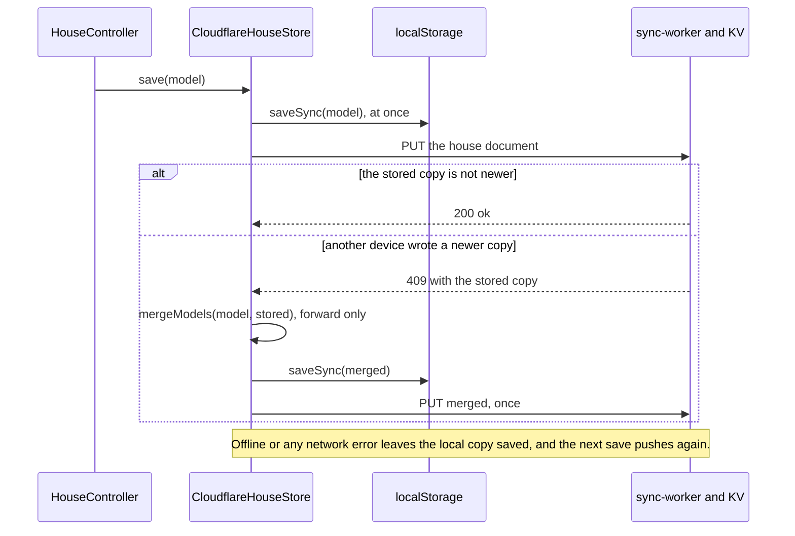

# Design: House sync

- `HouseStore` port (`src/adapters/store/types.ts`): `load()` and `save(model)`.
- `LocalHouseStore`: one JSON document in localStorage, with synchronous `loadSync`/`saveSync` for the first paint.
- `CloudflareHouseStore`: wraps the local store. `load` merges a GET into the local copy; `save` writes locally, then PUTs; on 409 it merges with `mergeModels` and PUTs once more. Network errors are swallowed after the local write.
- `createStores(env)` chooses the store from env and keeps a stable house id under `haunted-pomodoro/house-id`.
- `worker/sync-worker.ts`: a Workers module with an exported `handle(request, env)` so it can be tested without the Workers runtime. KV key `house:{uuid}`. Configuration example in `worker/wrangler.toml.example`.
- The house id is a random UUID and acts as a capability. A later version can add a per-house secret header.

## Saving with a conflict, as a diagram

## Testing
- The Worker handler is tested with an in-memory KV.
- The Cloudflare store is tested by routing its `fetch` calls into the Worker handler, covering push, pull and merge, the 409 retry and offline fallback. No real network is used.

## Notes from the Kiro pass
- Importing a house file (`src/core/house-file.ts`) calls the same `mergeModels`, so sync and import share the forward-only rule (Req 3.3).
- The push debounce (four seconds) lives in `buildController` in `src/App.tsx`, not in the store, so no unit test reaches it yet (tasks 9).
- On start-up the app calls `controller.replace(pulled)` with the store's merged copy. That is correct when nothing changed during the pull, and loses a change made during it (task 8).
- The Worker measures the body with `text.length`, which counts UTF-16 units, not bytes (task 3.1).
