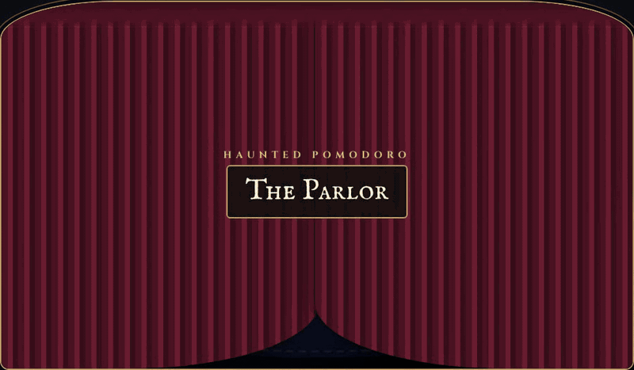
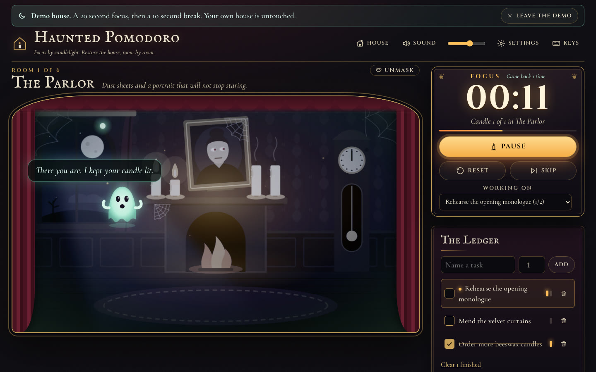

# Haunted Pomodoro

**Forest kills your tree when you look away. This ghost keeps your candle lit.**

A real Pomodoro timer wearing a haunted house: every focus session lights a candle, wandering off wakes a lonely ghost who counts it without taking anything away, and finished sessions restore the house room by room. Built for Kiroween 2026 (Costume Contest) by Stubborn Otter Software.

| Haunted | You wandered off | Restored |
|---|---|---|
|  |  |  |

> **Judges: 60 seconds.** Run `npm ci && npm run dev` and open `http://localhost:3180/?demo=1` (sound on).
> 1. Press **Light a candle**.
> 2. Switch to another tab for 5 seconds, then come back: the ghost says so kindly, and a will-o'-wisp stays in the room.
> 3. Wait for 0:00: the parlor is restored.
> 4. Press **U** to take the costume off (the same timer as a plain Pomodoro), and **U** again to put it back.
> 5. Press **H** for the house map and the ghost's journal. For the ending, open `/?demo=finale`.

## What it does that focus apps usually don't
- **It notices when you leave the tab.** The ghost wakes, rattles the room and calls you back from the tab strip ("Come back… 00:14 left").
- **It forgives every wandering, visibly.** Nothing you earned is ever taken away, and each time you come back the ghost leaves a will-o'-wisp in the room.
- **It gives back a lost book, page by page.** Each restored room returns a page of the ghost's unfinished book; six rooms finish it, she rests, and a new house waits down the lane.

## Why it matters
We drift constantly: Gloria Mark's logging studies put the average stretch on one screen before switching at about 47 seconds ([Mark, *Speaking of Psychology*, APA](https://www.apa.org/news/podcasts/speaking-of-psychology/attention-spans); [*Attention Span*, 2023](https://texasstandard.org/stories/attention-span-book-gloria-mark/)). Punishing the drift does not help either: among students who had procrastinated most before a first exam, those who forgave themselves for it procrastinated less before the next one ([Wohl, Pychyl and Bennett, 2010, *Personality and Individual Differences* 48(7), 803-808](https://doi.org/10.1016/j.paid.2010.01.029)). So this timer notices every wandering and forgives it.

## Who it is for
**People who quit a focus app because it punished them:** a dead tree, a sad pet, a broken streak. If you have ADHD or simply drift a lot, wandering here is counted, never penalised. It is a timer, not a treatment.

Also for students and knowledge workers who use Pomodoro timers but drift into other tabs, and anyone who wants their focus history to stay on their own device.

*A scenario, for illustration (not a user quote):* picture a student who deleted Forest after the fifth dead tree in a week. Here she wanders off twice, comes back to "There you are. I kept your candle lit.", finishes the session, and the parlor's color comes back anyway.

## Why not Forest?
| | When you look away mid-session | What you keep |
|---|---|---|
| [Forest](https://forestapp.cc/) | "Open another app, and the tree dies." (Forest's own FAQ) | Not that session's tree |
| [Focus Friend](https://apps.apple.com/app/id6742278016) | Stop the timer early and your bean is "really really sad" (its App Store listing) | A really really sad bean |
| **Haunted Pomodoro** | The ghost wakes, drifts closer and says something kind. The wandering is counted; the candle keeps burning. | Everything. No lit candle or restored room is ever taken away, and the Hearth forgives one missed day. |

The rule is written down and enforced, not just promised: [`.kiro/steering/product.md`](.kiro/steering/product.md) makes "Never punish" non-negotiable, and the [`never-punish-guard.json`](.kiro/hooks/never-punish-guard.json) hook re-checks it, and asks for a unit test, whenever house, streak, merge, reducer or import code changes.

## Why this is a costume
This is an entry for the **Costume Contest**: a real, daily-use Pomodoro timer wearing a haunted house. Take the costume off and every part still works as a timer: the candle is the progress bar, the ghost is the distraction counter, the Hearth is the streak, the house map is the long-term record, and breaks are the house breathing. The haunting is the interface itself: leaving the tab *is* what wakes the ghost. Press **U** and the costume really comes off: the same state, shown as a plain Pomodoro, with each number labelled with the part of the house behind it.

## Built with Kiro
| Feature | Files | What it actually did |
|---|---|---|
| Steering | [`.kiro/steering/`](.kiro/steering/) `product.md`, `tech.md`, `structure.md` (always); `scene-art.md`, `audio.md` (file match) | Sets the rules every session works under. "Never punish" is non-negotiable, and Kiro pass 1 was told to follow it. |
| Specs | [`haunted-focus-timer`](.kiro/specs/haunted-focus-timer/) and [`house-sync`](.kiro/specs/house-sync/): EARS requirements, design, tasks | Kiro pass 1 rewrote every criterion in EARS form, caught house-sync 4.1 saying 404 where the Worker answers 405, unchecked two tasks no test backed and opened tasks 24 to 30 for the gaps it found. |
| Feature work | `src/core/house-file.ts`, `src/adapters/notify.ts`, `src/core/notice.ts` and their tests | Kiro pass 1 built house export and import and the opt-in phase-end notification with unit and Playwright tests (11 min 44 s, 16.02 credits). |
| Traceability | [`traceability.md`](.kiro/specs/haunted-focus-timer/traceability.md), `npm run trace` | 152 of 161 criteria are named by a test; a unit test fails if the table is stale or a tag names a criterion that does not exist. |
| Hooks | [`.kiro/hooks/`](.kiro/hooks/): nine `v1` files | Save: unit tests, the never-punish guard, the accessibility and motion guard. Stop: the full check. PreToolUse: blocks dependency changes, `git push` and deploys with exit code 2. PostTaskExec: the trace check. SessionStart: open tasks. Manual: the demo-ready check. The newer four have been run by hand with Kiro's event payload ([`docs/kiro/hook-checks.txt`](docs/kiro/hook-checks.txt)) but have not fired inside a Kiro session yet. |
| Custom agent | [`.kiro/agents/ghost-reviewer.json`](.kiro/agents/ghost-reviewer.json) | A read-only reviewer of every line the ghost says, against the never-punish rule. Configured and schema-checked; not yet run. |
| MCP | [`.kiro/settings/mcp.json`](.kiro/settings/mcp.json) | Playwright MCP and Context7 at pinned versions. Configured; not yet used in a Kiro session. |

[`KIRO-LOG.md`](KIRO-LOG.md) records what was drafted before Kiro ran, every Kiro call with its prompt, result and credits, and a separate list of the work done outside Kiro.

## What works today
- **A real Pomodoro timer.** Configurable focus, short and long breaks, long break every N sessions, auto-start options, pause, resume, skip and reset. Time is kept as an absolute end time, so background tabs never drift, and a reload resumes exactly where you were.
- **Candles and rooms.** The drapes part over a brass title card when the house opens. Starting focus strikes a candle with a warm flare; it melts as the session runs while the room's color returns and the cobwebs thin. Four finished candles restore a room: the portrait stops staring and closes its eyes, the cobwebs fall, the clock starts ticking, and a band of warm light sweeps the wallpaper while the dust bursts off the room. The house map opens on the exterior, one glowing window per restored room. Six rooms per house, each with its own prop (grandfather clock, library, conservatory, piano, rocking horse, telescope).
- **The ghost.** Switch tabs during focus (Page Visibility API) and the ghost wakes after a short grace period, drifts closer (by the third wandering it fills the room and its green glow gathers at the edges), rattles the room and changes the tab title to call you back. Come back and it says something kind. Wanderings are counted per session and per day.
- **A story to restore.** The ghost is the house's last owner, who never finished her book. Each restored room gives back a page of it in the ghost's journal (in the house map); six rooms finish the book, she rests, and a new house begins. She has fifteen things to say when you come back, chosen by the room and how often you have wandered, and none of them scold.
- **Will-o'-wisps.** Each time you wander off and come back, the ghost leaves a small light near the ceiling: one per return that day, up to eight. They stay through the end of the session and a reload, and they are never taken away.
- **Unmask.** Press U, or the Unmask button above the room, and the house becomes a plain Pomodoro with the same timer, tasks and history, each number labelled with the part of the house that stands for it. Press it again and the costume is back, exactly where it was.
- **Breaks let the house breathe.** The room slowly swells and the curtains sway; the UI turns ghost-green.
- **The Hearth.** A streak that forgives one missed day between active days and never takes away a restored room. Fourteen-day candle chart, today's minutes, wanderings, best streak, a diary line in the ghost's voice ("Yesterday you lit three candles and left me twice. I counted the books while I waited.") and a weekly reflection ("This week: 11 candles, 4 h 35 min focused, 6 wanderings, down from 14."). It mentions wanderings going down, never up.
- **Task ledger.** Add tasks with planned candles, pick the active one, see candles spent, mark done, clear finished.
- **Sound, synthesized live.** Candle strike, bell chime, restoration arpeggio, ghost moan, rattle, break breath and optional ambient wind, all generated with Web Audio. Volume slider and mute on the main screen.
- **Sound check.** `/sound-check.html` renders every sound offline at full volume, draws its waveform, shows its peak, loudness and fade-out, and has a Play button for each. Every sound must peak between -28 and -1 dBFS and fade cleanly; the test suite enforces it. (This check caught a rattle that peaked at only -31 dBFS; it now uses white noise and peaks near -15.)
- **Fits the first view.** On desktop the stage scales with the window height, so the room, the timer and the Light a candle button are all visible at 1280x720 and up, with or without the demo banner.
- **Keyboard first.** Space, R, S, N, M, A, H, U, comma and ?. All controls are native, labelled and focus-visible; changes are announced in a live region.
- **Reduced motion.** Follows the system setting, or choose reduced or full theatre in settings.
- **Works offline.** Installable PWA with a generated service worker; fonts are self-hosted.
- **Private by default.** Everything lives in localStorage. Optional sync to a Cloudflare Worker is written and tested against a stub, and off unless configured.
- **Export and import.** Settings has "Export house", which downloads `haunted-house-YYYY-MM-DD.json`, and "Import house", which merges a saved file into the current house. The house with more candles wins, so an import never removes a candle or a room. Files over 1 MB, damaged files and files from another format version are refused with a message and change nothing. Both are disabled in demo mode.
- **Optional phase-end notification.** Off by default. "Notify me when a phase ends while this tab is hidden" asks for browser permission when you turn it on, turns itself off with a reason if permission is denied, and shows one notification per phase end only while the tab is hidden.
- **Demo mode.** `/?demo=1` runs a 20 second focus and a 10 second break in a demo house whose fully haunted parlor is restored by a single candle, without touching your own data. `/?demo=finale` starts in the house's last dark room: one session finishes the book, and the house map opens on the last page with a new house down the lane.

## Beyond Kiroween
Focus apps are a proven market: Forest says more than 60 million people have used it since 2014 ([forestapp.cc](https://forestapp.cc/), checked November 2026).

**Why now.** Gentle apps reach a mass market too: Finch, a self-care app built around a pet you look after rather than one you can fail, shows 10M+ downloads on Google Play alone ([Google Play](https://play.google.com/store/apps/details?id=com.finch.finch), checked November 2026). Haunted Pomodoro brings that kindness to focus, where the leading apps still punish. The plan keeps it cheap to run:
- **Free forever:** the whole local timer, house and Hearth, offline, with no account.
- **Sync, $2 a month or $15 a year:** the house on every device, through the Cloudflare Worker adapter that already exists behind the `HouseStore` port.
- **House packs, $3 each:** new houses with their own rooms, props, ghost and story (a lighthouse, a theatre, a ship).
- **Study-hall houses:** one shared house for a class or a team, where everyone's candles restore the same rooms. Body doubling, in the haunting's own language.

**Unit economics.** The free tier costs nothing to serve: it is a static site and the house lives on the device. For sync, Cloudflare's Workers Paid plan costs $5 a month and includes 10 million requests and 1 million KV writes ([Workers pricing](https://developers.cloudflare.com/workers/platform/pricing/), [KV pricing](https://developers.cloudflare.com/kv/platform/pricing/), checked November 2026). Assuming 50 house saves per subscriber per day (an estimate, not a measurement), that covers about 660 subscribers, or about $1,300 a month at $2 each, before any usage pricing.

## Run it and test it
`npm ci && npm run dev`, then `npm run check` for types, unit and end-to-end tests. [`docs/DEVELOPING.md`](docs/DEVELOPING.md) covers the build, the test suites, traceability, the architecture, the adapters and the free deploy.

## Credits
- Fonts, self-hosted through [Fontsource](https://fontsource.org) and licensed under the [SIL Open Font License 1.1](https://openfontlicense.org):
  - [Cinzel](https://fontsource.org/fonts/cinzel), copyright 2020 The Cinzel Project Authors.
  - [Cormorant Garamond](https://fontsource.org/fonts/cormorant-garamond), copyright 2015 The Cormorant Project Authors.
  - [IM Fell English SC](https://fontsource.org/fonts/im-fell-english-sc), from the Fell Types revival distributed through Google Fonts.
  - The full license text for all three ships with the site at [`public/licenses/fonts.txt`](public/licenses/fonts.txt) (served as `/licenses/fonts.txt`).
- Every illustration and sound was made for this project: the scene is hand-written SVG and the sounds are synthesized in the browser. No third-party images or recordings are used.
- Research cited above: Gloria Mark (UC Irvine) on screen attention; Michael Wohl, Timothy Pychyl and Shannon Bennett on self-forgiveness and procrastination.

## License
The code is MIT, see [LICENSE](LICENSE). The bundled fonts keep their own SIL Open Font License 1.1, listed under Credits.
