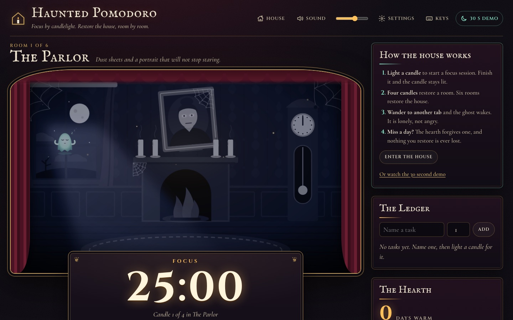

# Haunted Pomodoro

**A focus timer that lives in a haunted house: every focus session lights a candle, wandering off wakes the ghost, and finished sessions restore the house room by room.**

Built for Kiroween 2026 (Costume Contest) by Stubborn Otter Software.

| Haunted | You wandered off | Restored |
|---|---|---|
|  |  |  |

## Who it is for
- Students and knowledge workers who use Pomodoro timers but drift away from them, or drift into other tabs.
- People who respond to a gentle nudge better than to site blockers or guilt.
- Anyone who wants their focus history to stay on their own device.

## What works today
- **A real Pomodoro timer.** Configurable focus, short and long breaks, long break every N sessions, auto-start options, pause, resume, skip and reset. Time is kept as an absolute end time, so background tabs never drift, and a reload resumes exactly where you were.
- **Candles and rooms.** Starting focus lights a candle that melts as the session runs while the room's color returns and the cobwebs thin. Four finished candles restore a room: the portrait stops staring and closes its eyes, the cobwebs fall, the clock starts ticking. Six rooms per house, each with its own prop (grandfather clock, library, conservatory, piano, rocking horse, telescope).
- **The ghost.** Switch tabs during focus (Page Visibility API) and the ghost wakes after a short grace period, drifts closer, rattles the room and changes the tab title to call you back. Come back and it says something kind. Wanderings are counted per session and per day.
- **Breaks let the house breathe.** The room slowly swells and the curtains sway; the UI turns ghost-green.
- **The Hearth.** A streak that forgives one missed day between active days and never takes away a restored room. Fourteen-day candle chart, today's minutes, wanderings, best streak.
- **Task ledger.** Add tasks with planned candles, pick the active one, see candles spent, mark done, clear finished.
- **Sound, synthesized live.** Candle strike, bell chime, restoration arpeggio, ghost moan, rattle, break breath and optional ambient wind, all generated with Web Audio. Volume slider and mute on the main screen.
- **Sound check.** `/sound-check.html` renders every sound offline at full volume, draws its waveform, shows its peak, loudness and fade-out, and has a Play button for each. Every sound must peak between -28 and -1 dBFS and fade cleanly; the test suite enforces it. (This check caught a rattle that peaked at only -31 dBFS; it now uses white noise and peaks near -15.) The limits are measured; a listening review of each sound's character is still to come.
- **Fits the first view.** On desktop the stage scales with the window height, so the room, the timer and the Light a candle button are all visible at 1280x720 and up, with or without the demo banner.
- **Keyboard first.** Space, R, S, N, M, A, H, comma and ?. All controls are native, labelled and focus-visible; changes are announced in a live region.
- **Reduced motion.** Follows the system setting, or choose reduced or full theatre in settings.
- **Works offline.** Installable PWA with a generated service worker; fonts are self-hosted.
- **Private by default.** Everything lives in localStorage. Optional sync to a Cloudflare Worker is written and tested against a stub, and off unless configured.
- **Demo mode.** `/?demo=1` runs a 20 second focus and a 10 second break in a house whose parlor is one candle from restored, without touching your own data.

## Run it
```bash
npm install
npm run dev        # http://localhost:3180
npm run build && npm run preview   # production build with the service worker, http://localhost:3181
```
Open `http://localhost:3180/?demo=1` for the 30 second demo, and `http://localhost:3180/sound-check.html` to hear and measure every sound.

## Test it
```bash
npm run typecheck
npm test           # Vitest unit tests
npx playwright install chromium   # once
npm run test:e2e   # Playwright against the production build on port 3182
npm run check      # all three
```
The end-to-end suite uses Playwright's fake clock to run the whole demo arc: light a candle, hide the tab, watch the ghost call, come back, finish the session, see the parlor restored, breathe through the break, and arrive in the library. It also covers reload persistence, keyboard shortcuts, sound controls, the house map, the first-visit guide, offline reload, reduced motion, a phone-width layout, first-view fit at 1280x720, 1366x768 and 1920x1080, level limits for all eight sounds rendered in Chromium's OfflineAudioContext, and axe-core WCAG 2.1 A/AA scans of the main screen, the restored room, settings, the house map and the sound check page.

## Architecture
```
src/core        pure domain logic: timer state machine, house, streak, reducer, snapshot/merge
src/adapters    HouseStore port: local (localStorage) and cloudflare (sync Worker)
src/app         HouseController (model + persistence + cues), demo seed
src/audio       Web Audio sound engine, offline renderer and level measurements
src/sound-check the /sound-check.html page
src/ui          SVG scene, plaque, ledger, hearth, dialogs
worker/         optional Cloudflare Worker (Workers KV) for sync
```
The core never reads the clock or touches the DOM: `step(state, action, now, config)` returns the next timer state and effects, and `reduceApp` turns those effects into candles, task credit, day logs and UI cues. The scene is one hand-drawn SVG whose restoration is driven by a single CSS custom property (`--restore`), so color, cobwebs and the portrait's tilt move together.

## Adapters: local and real
| Port | Local (default, used by the app and tests) | Real (written and type-checked, not called by default) | Switch |
|---|---|---|---|
| House store | `LocalHouseStore`: one JSON document in localStorage | `CloudflareHouseStore` + `worker/sync-worker.ts`: Workers KV, merge on conflict | `VITE_HOUSE_STORE=cloudflare` and `VITE_SYNC_URL` (see `.env.example`) |
| Sound | Web Audio synthesis | none needed | settings |

## Deploy (free)
The app is a static site: deploy `dist/` to Cloudflare Pages (free tier). The optional sync Worker deploys with `wrangler deploy` using `worker/wrangler.toml.example` and a free KV namespace. Nothing is deployed from this repository.

## Built with Kiro
- `.kiro/steering/`: product rules (never punish, honest timer, local data, accessible theatre), tech stack and structure.
- `.kiro/specs/haunted-focus-timer/` and `.kiro/specs/house-sync/`: EARS requirements, design and task lists mapped to requirement numbers.
- `.kiro/hooks/`: unit tests on core saves, a never-punish guard, an accessibility and motion guard and a full check on stop (the `v1` hook files), plus the same core-tests rule as a Kiro IDE `.kiro.hook` file. The IDE file format will be confirmed in the Kiro pass; see the log.
- [`KIRO-LOG.md`](KIRO-LOG.md) records what was drafted before Kiro ran and every Kiro call since.

## Credits
- Fonts, self-hosted through [Fontsource](https://fontsource.org) and licensed under the [SIL Open Font License 1.1](https://openfontlicense.org):
  - [Cinzel](https://fontsource.org/fonts/cinzel), copyright 2020 The Cinzel Project Authors.
  - [Cormorant Garamond](https://fontsource.org/fonts/cormorant-garamond), copyright 2015 The Cormorant Project Authors.
  - [IM Fell English SC](https://fontsource.org/fonts/im-fell-english-sc), from the Fell Types revival distributed through Google Fonts.
  - The full license text for all three ships with the site at [`public/licenses/fonts.txt`](public/licenses/fonts.txt) (served as `/licenses/fonts.txt`).
- Every illustration and sound was made for this project: the scene is hand-written SVG and the sounds are synthesized in the browser. No third-party images or recordings are used.

## License
The code is MIT, see [LICENSE](LICENSE). The bundled fonts keep their own SIL Open Font License 1.1, listed under Credits.
