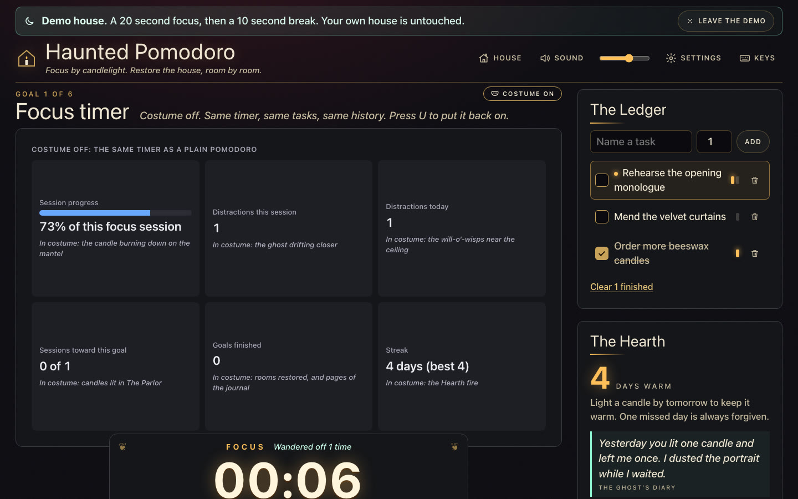
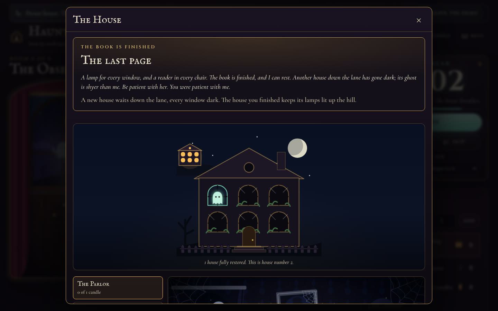

# Haunted Pomodoro

**Forest kills your tree when you look away. This ghost keeps your candle lit.**

A real Pomodoro timer wearing a haunted house. Every focus session lights a candle. Wander to another tab and a lonely ghost wakes, calls you back and counts the comeback, without taking anything away. Finished sessions restore the house room by room. Built for Kiroween 2026 (Costume Contest) by Stubborn Otter Software.

**Kiro at a glance:** 2 specs · 168 EARS criteria, 159 traced to tests · 9 hooks on 6 triggers · 5 steering files · 2 MCP servers · 1 custom agent · 1 logged Kiro session (16.02 credits) that caught a spec bug and built two features. [Built with Kiro](#built-with-kiro) · [KIRO-LOG.md](KIRO-LOG.md)

> **Judges: 60 seconds.** Run `npm ci && npm run dev` and open `http://localhost:3180/?demo=1` (sound on).
> 1. Press **Light a candle**.
> 2. Switch to another tab for 5 seconds, then come back: the ghost says so kindly, and a will-o'-wisp stays in the room.
> 3. Wait for 0:00: the parlor is restored.
> 4. Press **U** to take the costume off (the same timer as a plain Pomodoro), and **U** again to put it back.
> 5. Press **H** for the house map and the ghost's journal. For the ending, open `/?demo=finale`.

## What it does that focus apps usually don't
*It doesn't count your distractions. It counts your comebacks.*

- **It notices when you leave the tab.** The ghost wakes, rattles the room and calls you back from the tab strip ("Come back… 00:14 left").
- **It forgives every wandering, visibly.** The timer reads "Came back 2 times", nothing you earned is ever taken away, and each comeback leaves a will-o'-wisp in the room. The weekly number that goes down is time away, never a tally of failures.
- **It gives back a lost book, page by page.** Each restored room returns a page of the ghost's unfinished book; six rooms finish it and she rests.

| Haunted | You wandered off | Restored |
|---|---|---|
|  |  |  |

| Costume off (press U) | The last page (`?demo=finale`) |
|---|---|
|  |  |

## Why this is a costume
Take the costume off and every part still works as a timer: the candle is the progress bar, the ghost is the comeback counter, the Hearth is the streak, the house map is the long-term record, and breaks are the house breathing. Leaving the tab *is* what wakes the ghost. Press **U** and the costume really comes off.

## Built with Kiro
| Feature | Files | What it did |
|---|---|---|
| Specs | [`haunted-focus-timer`](.kiro/specs/haunted-focus-timer/) and [`house-sync`](.kiro/specs/house-sync/) | Kiro rewrote every criterion in EARS form, caught house-sync 4.1 saying 404 where the Worker answers 405, unchecked two tasks no test backed and opened a task for each gap. |
| Spec-driven build | `src/core/house-file.ts`, `src/adapters/notify.ts` and their tests | Kiro built house export and import and the opt-in phase-end notification from its own criteria, with unit and Playwright tests (11 min 44 s, 16.02 credits). |
| Steering | [`.kiro/steering/`](.kiro/steering/): 3 always, 2 by file match | "Never punish" is non-negotiable: nothing removes a lit candle or a restored room. |
| Traceability | [`traceability.md`](.kiro/specs/haunted-focus-timer/traceability.md), `npm run trace` | 159 of 168 criteria are named by a test; a unit test fails if the table is stale. |
| Hooks | [`.kiro/hooks/`](.kiro/hooks/): nine `v1` hooks | Save: unit tests and the never-punish and accessibility guards. Stop: the full check. PreToolUse: blocks dependency changes, `git push` and deploys. PostTaskExec: the trace. SessionStart: open tasks. Manual: demo-ready. Each command is verified with Kiro's event payload ([`hook-checks.txt`](docs/kiro/hook-checks.txt)). |
| Agent and MCP | [`ghost-reviewer`](.kiro/agents/ghost-reviewer.json), [`mcp.json`](.kiro/settings/mcp.json) | A read-only reviewer of every line the ghost says; Playwright MCP and Context7 at pinned versions. Both join the next Kiro session. |

The first build and most of the visual work were written with Claude Code. [`KIRO-LOG.md`](KIRO-LOG.md) lists every Kiro session with its prompt, result and credits, and the work done outside Kiro commit by commit.

## Who it is for, and why
**People who quit a focus app because it punished them:** a dead tree, a sad pet, a broken streak. If you have ADHD or simply drift a lot, wandering here is counted, never penalised. It is a timer, not a treatment.

We drift constantly: Gloria Mark's logging studies put the average stretch on one screen at about 47 seconds ([APA](https://www.apa.org/news/podcasts/speaking-of-psychology/attention-spans)). Punishing the drift does not help either: students who forgave themselves for procrastinating before one exam procrastinated less before the next ([Wohl, Pychyl and Bennett, 2010](https://doi.org/10.1016/j.paid.2010.01.029)). So this timer notices every wandering and forgives it.

*A scenario, for illustration (not a user quote):* a student deletes Forest after the fifth dead tree in a week. Here she wanders off twice, comes back to "There you are. I kept your candle lit.", and the parlor's color comes back anyway.

## Why not Forest?
| | When you look away mid-session | What you keep |
|---|---|---|
| [Forest](https://forestapp.cc/) | "Open another app, and the tree dies." (Forest's own site) | Not that session's tree |
| [Focus Friend](https://apps.apple.com/app/id6742278016) | Stop early and your bean is "really really sad" (its App Store listing) | A really really sad bean |
| **Haunted Pomodoro** | The ghost wakes, drifts closer and says something kind. The candle keeps burning. | Everything, and the Hearth forgives one missed day. |

**Built for the desk, where the 47-second switches happen.** Forest covers the desk too, with a Chrome extension used by about 900,000 people ([Chrome Web Store](https://chromewebstore.google.com/detail/forest-stay-focused-be-pr/kjacjjdnoddnpbbcjilcajfhhbdhkpgk)) that blocks sites. This timer blocks nothing: it runs in any browser tab, offline, and counts the comeback.

## Beyond Kiroween
Gentle apps reach a mass market: Finch, built around a pet you look after rather than one you can fail, shows 10M+ downloads on Google Play ([Google Play](https://play.google.com/store/apps/details?id=com.finch.finch)). Forest is now free with a subscription at $5.99 a month or $35.99 a year (US App Store, checked November 2026); every paid tier here costs less.
- **Free forever:** the whole timer, house and Hearth, offline, with no account.
- **Study-hall house, $12 a month per group:** the lead paid tier. One shared house for a study group or a TA's exam-week section, where everyone's candles restore the same rooms: body doubling in the haunting's own language. The buyer is the person who runs the group.
- **Sync, $2 a month or $15 a year:** your house on every device, through the Cloudflare Worker adapter that already exists behind the `HouseStore` port.
- **House packs, $3 each:** new houses with their own rooms, ghost and story.

The free tier costs nothing to serve: a static site, with the house on the device. Paid tiers run on Cloudflare's $5 Workers plan, which includes 10 million requests a month ([pricing](https://developers.cloudflare.com/workers/platform/pricing/)).

## More
- [`docs/FEATURES.md`](docs/FEATURES.md): every feature as built and tested.
- [`docs/DEVELOPING.md`](docs/DEVELOPING.md): build, tests (`npm run check`), traceability, architecture and the free deploy.
- [`CHANGELOG.md`](CHANGELOG.md): what changed, newest first.

Credits

- Fonts, self-hosted through [Fontsource](https://fontsource.org) under the [SIL Open Font License 1.1](https://openfontlicense.org): [Cinzel](https://fontsource.org/fonts/cinzel) (copyright 2020 The Cinzel Project Authors), [Cormorant Garamond](https://fontsource.org/fonts/cormorant-garamond) (copyright 2015 The Cormorant Project Authors) and [IM Fell English SC](https://fontsource.org/fonts/im-fell-english-sc) (the Fell Types revival). The license text ships at [`public/licenses/fonts.txt`](public/licenses/fonts.txt).
- Every illustration and sound was made for this project: the scene is hand-written SVG and the sounds are synthesized in the browser.
- Research cited: Gloria Mark (UC Irvine) on screen attention; Michael Wohl, Timothy Pychyl and Shannon Bennett on self-forgiveness and procrastination.

## License
MIT, see [LICENSE](LICENSE). The bundled fonts keep their SIL Open Font License 1.1.
